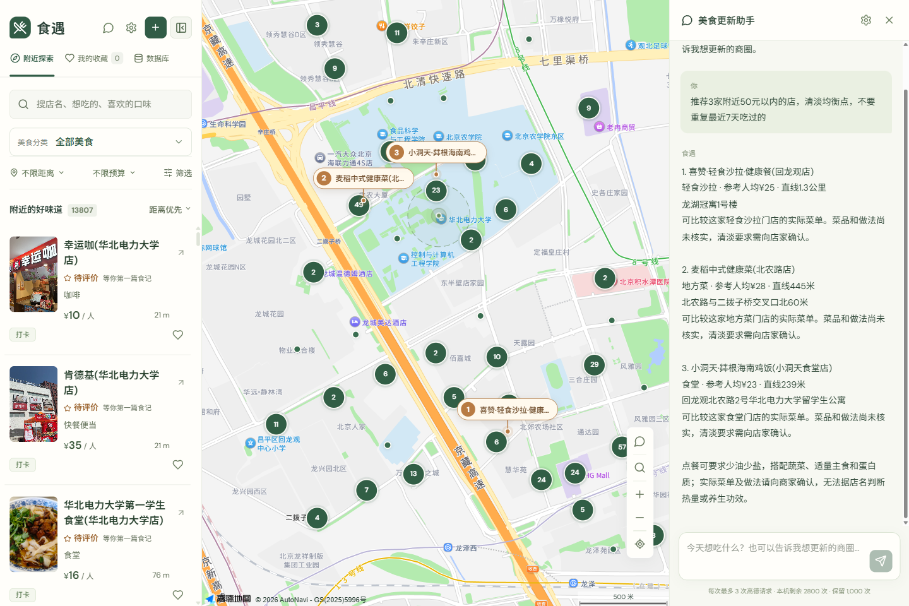

# 食遇 Tasty · v1.4.0

[](https://github.com/UUUUDDDD12/Food-Map/releases/tag/v1.4.0)  [](LICENSE)

以华北电力大学北京校区为起点的美食地图。侧栏筛选、地图聚合卡片、收藏和食记，都围绕“附近吃什么”展开。

## 下载使用

> [!IMPORTANT]
> **升级前请先退出旧版，并备份整个 `系统文件/data` 文件夹。**
> 关闭浏览器不会退出后台，请在系统托盘中选择“退出食遇”。将新版完整解压到新文件夹，把备份的 `data` 文件夹复制到新版的 `系统文件/data`，**完成迁移后再启动新版**。
> 这样可以迁移店铺资料、收藏、评价、打卡、上传图片和已保存的地图配置。请继续使用原浏览器，保留原有Cookie，以便继续管理自己的收藏、评价和打卡。

Windows 10 / 11 x64：在本仓库的 [Releases](https://github.com/UUUUDDDD12/Food-Map/releases/latest) 下载 `Tasty-1.4.0-windows-x64.zip`，完整解压后双击 **食遇.exe**。无需安装Node.js。不要把GitHub自动生成的“Source code”压缩包当作免安装版。

首次启动选择高德地图或备用地图。高德使用下载者自己的Web端（JS API）Key和安全密钥，可从侧栏齿轮进入“地图设置”修改。Key与安全密钥分别来自[高德开放平台](https://lbs.amap.com/api/javascript-api-v2/prerequisites)，密钥仅保存在本机，保存后返回地图即可应用。地图需要联网。

附带13,807家脱敏门店基础资料，首次启动写入自己的本地数据库。没有作者的密钥、收藏、评价、打卡或实拍上传文件。公开图片采用来源链接，不代表商家实时营业；数据与图片来源、使用说明见 [DATA_NOTICE.md](DATA_NOTICE.md)。

[下载 v1.4.0](https://github.com/UUUUDDDD12/Food-Map/releases/tag/v1.4.0) · [图文使用指南](docs/使用指南.md) · [版本更新记录](CHANGELOG.md)


## API 配置均为可选

**高德 API 和 DeepSeek API 都不是必填项。** 不配置时，首次启动选择“备用地图”并保存，即可浏览附带门店、筛选、查看图片、收藏、打卡、评价和编辑本机数据库。

| 配置情况 | 可以使用 | 功能限制 |
| --- | --- | --- |
| 两项都不填 | 备用地图、附带门店、筛选、收藏、打卡、评价、数据库维护 | 无高德底图、地址搜索、添加新店的高德匹配、AI 商圈更新 |
| 仅配置高德 | 上述功能，加高德地图、地址搜索定位、添加新店的关键词匹配 | 无 AI 商圈更新 |
| 仅配置 DeepSeek | 基础功能、一般对话、结合自己打卡的本地门店推荐，并在备用地图定位 | 更新商圈门店仍需要高德，不能由模型编造门店入库 |
| 两项都配置 | 全部功能，包括地图内 AI 商圈对话、真实门店查询和自动去重更新 | 受各平台余额、权限、额度及网络情况影响 |

### 配置及使用方法

1. 从侧栏齿轮进入设置，两张卡片分别配置，互不要求必填。
2. 需要高德功能时，填写 **Web端（JS API）Key** 和对应安全密钥并保存；[高德申请说明](https://lbs.amap.com/api/javascript-api-v2/prerequisites)。地址搜索在地图工具栏的放大镜中，添加新店时输入店名后选择匹配结果。
3. 需要 AI 更新时，前往 [DeepSeek 开放平台](https://platform.deepseek.com/)创建 API Key。在右侧填写 API 地址（默认 `https://api.deepseek.com`）、密钥，并选择 `deepseek-v4-pro`（默认）或 `deepseek-flash`，保存 AI 配置。
4. 回到地图，点击对话图标，在当前地图面板输入“更新沙河万达附近2公里的火锅和自助餐”。多个地点匹配时选择准确位置，随后自动查询、分页和去重入库；地图每批刷新，可边聊边看点位变化。
5. 可继续说“那里再找自助餐，范围缩小到1公里”。收起面板保留当前对话并继续更新；停止按钮结束任务，已保存的数据保留。

### 对话中推荐吃什么

直接说“推荐3家附近50元以内的店，清淡点，别重复最近吃过的”。助手按当前浏览器自己的打卡日期、星级与收藏筛选本地真实门店，默认避开近7天打卡店和低分店；没有记录也能正常推荐。回复介绍店名、参考人均、地址、距离与推荐依据，地图会同时编号标出多家店，点击可打开详情。说“换几家”会避开上一轮推荐。



推荐使用本地数据库，不消耗高德搜索次数，配置DeepSeek即可配合备用地图使用。需向DeepSeek发送本次对话、自己的聚合偏好和少量候选资料；不会读取其他访客的打卡。健康需求仅给一般膳食和点餐建议，未知菜单、热量、营养及过敏原信息不会当成已核实事实，也不承诺养生疗效。

### 调用额度和数据限制

- **默认每轮最多调用高德 2,000 次。** 若扣除保留的1,000次后不足2,000次，按实际可用次数缩小任务上限；搜完即停，不会为了用满次数而继续调用。
- 高德剩余次数是本机估算，无法自动读取控制台总余额；请在设置中按控制台校正。同一Key在其他应用的消耗、跨月额度变化也需重新校正。次数限制不是可返回店铺数量的保证。
- 单次处理一个商圈，半径500–5,000米。高德可能限制分页和结果总量，信息不保证实时营业；模型只负责理解需求，入库必须来自高德真实结果。未知口味、就餐方式留空。
- DeepSeek 对话消耗自己的模型余额；高德查询消耗自己的搜索额度。程序不提供共享密钥、免费额度、账号或充值服务。
- 密钥只保存本机；对话内容会发给DeepSeek，搜索词和地点会发给高德。配置、对话、收藏、评价及打卡不包含在公开下载包中。
- 备用地图和公开图片仍需联网，受网络及第三方服务可用性影响；不配置API不等于离线地图。

[AI商圈更新详细说明](docs/AI商圈更新.md) · [完整图文指南](docs/使用指南.md)

## 功能

- 高德地图及备用底图；店名匹配自动填写地址和位置，支持全国地址搜索定位。
- 地图内AI对话理解商圈，定位并分批更新真实门店；每批入库同步刷新地图。
- 自助餐、火锅、烤肉等分类；距离、预算、口味筛选。
- 地图随缩放由聚合变为独立小点，再显示店名并自动避让。
- 聚合卡片支持多店滚动，同点多个收藏分别展开；所有卡片支持拖动。
- 每次打卡保留日期和1–3星，支持删除误打卡。
- 店铺详情、多张图片、个人收藏和本机访客评价。
- SQLite可视化表格管理，可搜索、预览图片和编辑门店。

这是本机应用：不同下载者的数据各自独立，不提供公共账号、云同步或共享评价。只监听127.0.0.1，不需要开放公网端口。GitHub Pages不能直接运行这个Node后端。

## 从源码运行

需要Node.js 24或更新版本。

```sh
npm ci
npm test
npm run build
npm start
```

浏览器打开 http://localhost:3000，地图设置为 http://localhost:3000/settings。开发调试使用 `npm run dev`。

附带门店快照以starter-data/下的压缩分片保存，首次导入前校验SHA256。开发者可通过显式导出脚本重新生成公开快照；个人数据与公开快照分开。

实际数据库：`data/tasty.sqlite`；上传图片：`data/uploads/`；地图配置：`data/map-settings.json`。这些文件已经加入.gitignore，不要公开上传。也兼容根目录.env中的旧配置，但在设置页保存后的配置优先生效。

## 构建Windows免安装包

在Windows x64机器上执行：

```sh
npm ci
npm test
npm run package:windows
```

输出在 `release/`：完整运行目录、ZIP和SHA256文件。构建脚本下载固定版本的官方Node运行时并核验官方SHA256，编译带图标的启动器，内置Node和后端依赖；不使用机器上的个人数据库或地图凭据。构建后会对一次性副本执行真实启动检查。

启动后通过系统托盘菜单打开地图、进入设置或退出后台服务。备份数据前请先选择“退出食遇”。此便携版未签名，Windows可能显示发行者提示；请核对Release校验文件。

## 发布到GitHub

将本源码目录推送到新仓库。GitHub Actions中的“Windows release”支持手动运行，产物可从Actions下载。

首次将源码（包括package.json与工作流）推送到main，以及之后在main更新版本号，会自动构建并创建对应Release。也可以推送与package.json一致的版本标签：

```sh
git tag v1.4.0
git push origin v1.4.0
```

更新版本时先调整package.json和package-lock.json。GitHub无需配置作者的高德密钥，下载者在自己的设置页填写。

代码采用 [MIT](LICENSE)；第三方依赖、门店资料和图片各自保留原来源与许可。地图Logo、审图信息及来源署名保留。
