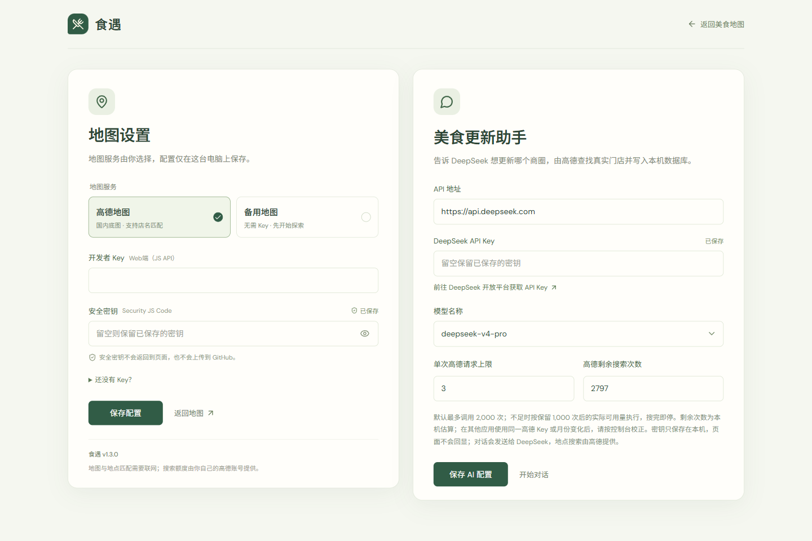

# AI 商圈美食更新

在侧栏或地图工具栏点击对话图标展开美食更新助手，或从地图设置下方的“美食更新助手”进入。

## 配置

高德API和DeepSeek API均为可选项；不配置可使用备用地图和附带门店，AI自动更新需要同时配置两者。

在设置页填写官方 DeepSeek API 地址（默认 https://api.deepseek.com）、API Key 和模型名称（默认 deepseek-v4-pro），保存 AI 配置。模型可在 deepseek-v4-pro 和 deepseek-flash 中选择。可前往 [DeepSeek 开放平台](https://platform.deepseek.com/)申请 API Key。高德仍使用地图设置中的 Web 端 JS API Key 和安全密钥，不需要额外购买模型工具。

密钥保存在本机系统文件/data/ai-settings.json，页面只显示是否已保存，输入框留空保留原密钥。请勿公开此文件。发送消息会将当前会话的对话和商圈需求发给 DeepSeek，模型调用按其账号计费；高德查询消耗自己的搜索额度。

单次任务默认最多2,000次高德请求，可设置2–2,000次；若保留1,000次后不足2,000，按实际可用量执行；搜完即结束，不会刻意用满。高德剩余次数为本机估算，旧采集计数仅作保守初值；需要按控制台校正，同一Key在其他应用的消耗不会自动得知。达到1,000次保留下限即停止；月份变化需重新校正，不会擅自重置额度。

## 使用

直接输入“沙河万达”，助手会按默认北京、半径1.5公里、全部餐饮处理。也可以说“更新霍营附近2公里的火锅和自助餐”。同名候选会显示名称和地址，选择准确地点后自动开始搜索。

接着说“那里再找自助餐，范围缩小到1公里”，模型会结合当前会话理解。每次处理一个商圈，半径500–5000米，支持多个餐饮关键词、分页和停止。会话暂存在本机服务内存中，重启服务后清空。

系统只把高德实际返回的餐饮地点写入库，按地点ID去重，只补齐已有记录的空图片、电话、人均，不覆盖人工内容，也不删除收藏、评价和打卡。没有依据的口味和就餐方式留空。对话就在地图内的右侧面板，手机端为上方地图、下方对话；选择商圈后地图自动定位，每页完成即保存并刷新地图；停止或失败后，已保存的结果保留。更新结束会显示新增、补齐、重复和实际请求数；达到上限不代表所有门店都已收录。

配置和对话仅允许本机访问。未来发布包继续只附带脱敏门店快照，不包含AI密钥、对话或个人资料。

## 在同一对话中推荐吃什么

直接问“今天有什么推荐，清淡点，50元以内，别重复最近吃过的店”。不必新增门店、不必提供商圈。助手会查询当前地图探索中心附近的真实本地门店，读取当前浏览器自己打卡的日期、星级及收藏，推断偏好；默认避开近7天到访和平均低分门店。预算、距离、品类和不想吃的内容会参与筛选；用户没有打卡记录时正常推荐，不声称了解其历史偏好。明确说商圈时优先匹配库中的名称与地址。

回复介绍店名、已知类别、参考人均、距离、地址及推荐理由；多家店会在地图同时以编号标记，编号与介绍对应，点击标记可查看店铺。说“换几家”会避免刚刚推荐过的店。无符合条件的门店会请你放宽条件，不会悄悄把近期到访店放回或编造门店。此推荐查询本地数据库，不消耗高德搜索次数，配置了DeepSeek即可使用备用地图定位。

模型需接收本次需求、会话上下文、自己的聚合偏好和少量候选资料以完成推荐；不会读取或发送其他浏览器访客的打卡记录，也不发送密钥。推荐通常进行两次模型调用（理解条件、从候选中选择），计费使用自己的DeepSeek账号。

健康相关仅参考《中国居民膳食指南（2022）》的一般原则，如食物多样、荤素搭配、少油少盐；并非医疗或治疗方案。餐厅的真实菜单、营养数据、过敏原及做法未核实，不能凭分类推断“养胃”“排毒”或保证过敏安全，需向商家确认；疾病等特殊需求请遵循专业建议。[中国营养学会指南](https://www.cnsoc.org/bookpublica/0522202019.html)。
