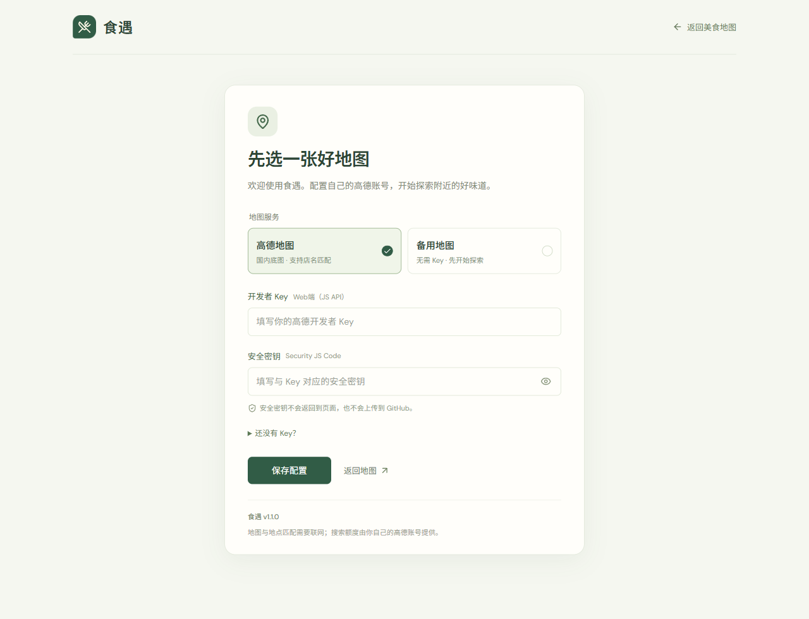
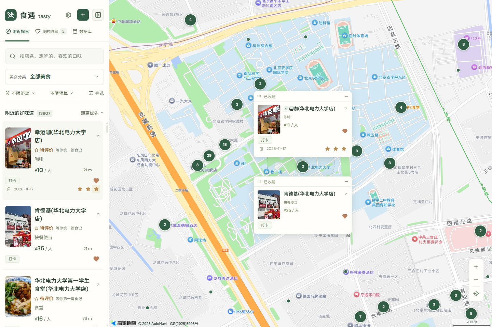
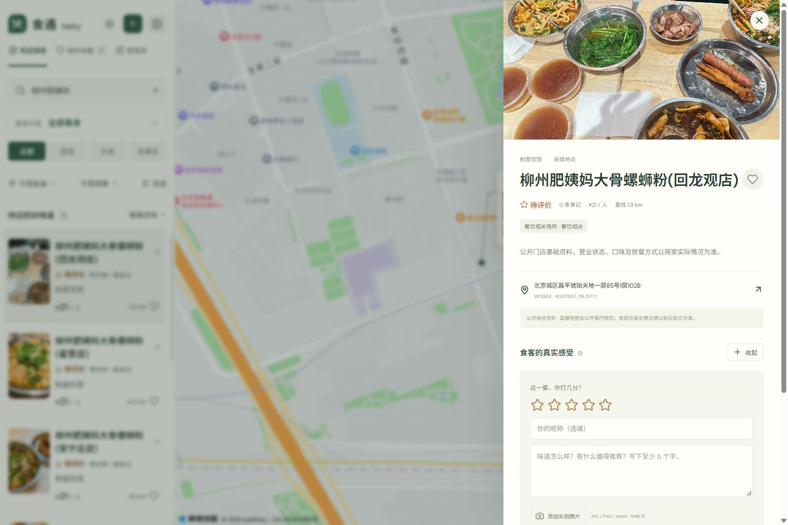
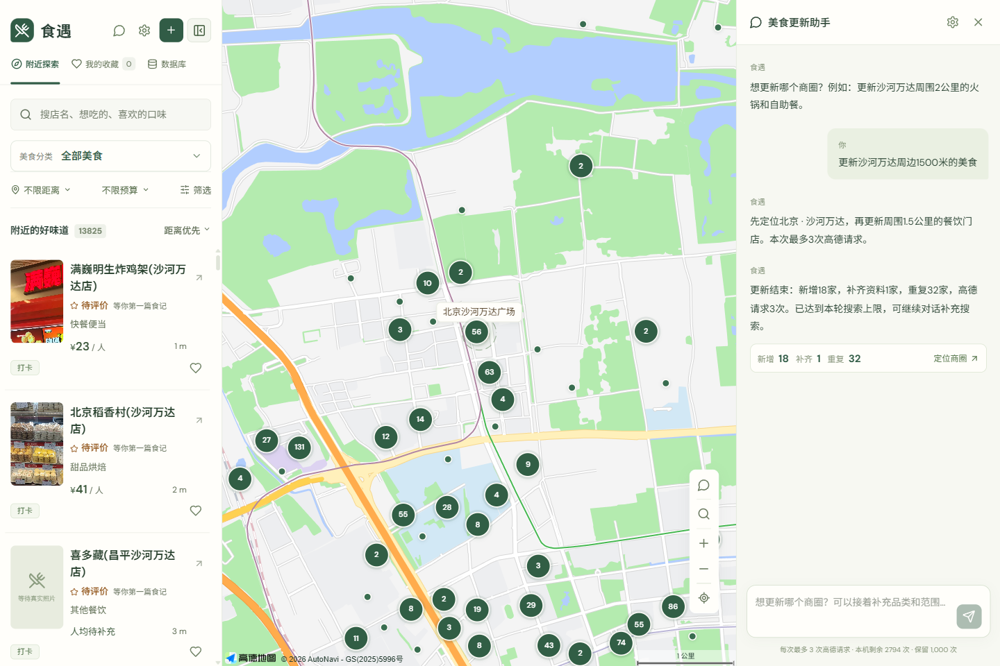
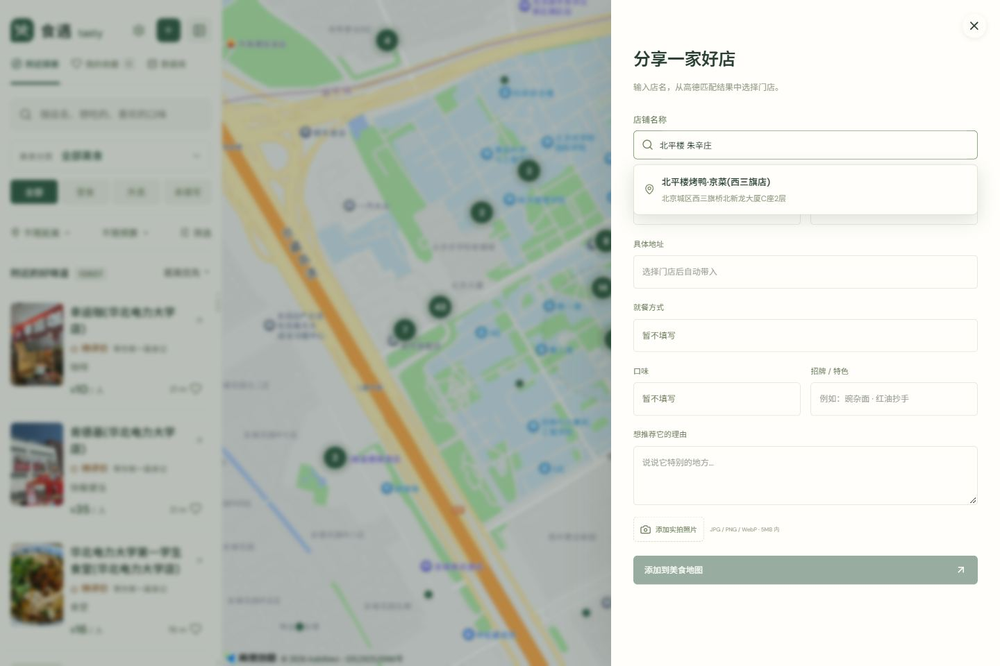
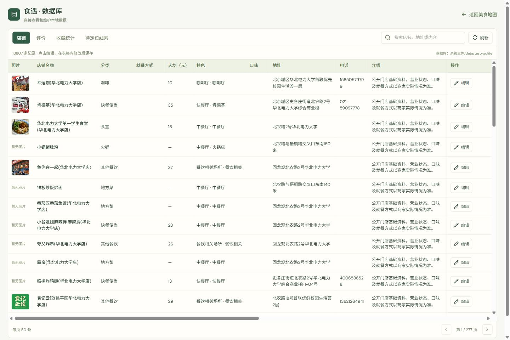

# 食遇 v1.3.0 · 图文使用指南

本指南适用于Windows 10 / 11 x64免安装版。不同下载者的数据各自保存在本机；地图和公开图片需要联网。

## 1. 下载、解压、打开

1. 打开 [v1.3.0下载页](https://github.com/UUUUDDDD12/Food-Map/releases/tag/v1.3.0)。
2. 在Assets中下载 **Tasty-1.3.0-windows-x64.zip**。不要选择Source code作为免安装版。
3. 把ZIP**完整解压**到有写入权限的普通文件夹，例如桌面或文档目录。不要直接在压缩软件里运行EXE。
4. 双击文件夹中的 **食遇.exe**。程序会启动本机服务并打开浏览器，无需安装Node.js。

程序使用系统托盘图标管理后台；关闭浏览器不会停止服务。右键托盘图标可重新打开地图、进入设置或退出食遇。

## 2. 首次配置高德（可选）

**高德和DeepSeek API均非必填。** 不填时选择备用地图保存，即可使用附带门店、筛选、收藏、打卡、评价与数据库维护。高德底图、地址搜索及新增店名匹配需要高德配置；AI商圈更新需要同时配置高德与DeepSeek。

1. 首次启动会进入配置页面；之后可以点击地图侧栏右上角的**齿轮**进入“地图设置”。
2. 选择“高德地图”。
3. 在[高德开放平台](https://lbs.amap.com/api/javascript-api-v2/prerequisites)创建应用、添加 **Web端（JS API）** 类型的Key。
4. 分别填写开发者Key和与它配套的安全密钥（Security JS Code）。不要使用Android、iOS或Web服务类型的Key代替。
5. 点击“保存配置”，出现保存成功提示后点击“进入美食地图”。无需重启。

保存后的安全密钥不会重新显示在页面里；再次打开设置时显示“已保存”，输入框留空表示继续使用原密钥。更换Key时，应同时填写新Key配套的安全密钥。

高德Key需要允许本机地址localhost；遇到域名白名单错误时按官方文档检查自己的控制台设置。地图、店名匹配和搜索额度由自己的账号提供，程序不会自动批量采集。

暂时没有Key可选择“备用地图”并保存，先浏览附带门店；新增店铺的高德关键词匹配需要配置高德。

## 3. 找店与筛选

| 位置 | 操作 |
| --- | --- |
| 搜索框 | 输入店名、想吃的美食或口味，筛选本机数据库中的记录 |
| 美食分类 | 点击后选择自助餐、火锅、烤肉、粉面等分类，菜单可滚动 |
| 距离与预算 | 点击后滑动选择，也可输入数值；支持不限距离与不限预算 |
| 地图标记 | 点击查看店铺卡片；拖动地图、滚轮或右下角加减号缩放 |
| 同址或相近店铺 | 点击带数字的聚合标记，卡片可同时展示多家店，向下滚动查看其余店铺；同点多个收藏独立展开 |

地图逐级放大时，相近店铺先拆成独立小点，继续放大后在点下方显示餐厅名称；重叠名称自动避让。完全同址的店铺仍可通过聚合卡片滚动查看，不会伪造位置。

拖动卡片顶部的把手可调整位置，引线跟随移动；触屏可直接拖动，键盘聚焦把手后用方向键微调，按住Shift可加快移动。

地图默认以华北电力大学北京校区为中心，默认不限距离。侧栏可收起，把更多空间留给地图。距离显示为直线距离，不是步行路线距离。

## 4. 查看详情、收藏、评价

点击列表或地图卡片打开详情，可查看照片、地址、参考人均及已有食记。有多张图片的店铺可点击缩略图切换。

点击**爱心**收藏，已收藏店铺在地图上默认展开；其余默认收起，也可点击标记手动展开。侧栏“我的收藏”只显示当前浏览器的收藏。

点击“写食记”，选择1–5星，填写至少5个字；昵称可选，也可上传实拍图片后发布。当前浏览器可以删除自己发布的评价。评价只保存在这台电脑的数据里，不会自动同步给其他下载者。

收藏、评价与打卡归属依赖当前浏览器的本机访客标识。换浏览器或清除Cookie可能无法继续管理以前的收藏、评价与打卡，但不会自动删除数据库里的内容。

### 打卡：只记日期和星级

在列表、地图卡片或详情中点击**打卡**，立即记下当天日期。每去一次点击一次，随后选择1–3颗星即可，不需要填写文字。同一天的多次打卡分别保留。

每条日期前的小垃圾桶可删除该次误打卡及其星级，其他记录保留；删除后立即保存。

### 在地图内和AI一起更新商圈

点击侧栏或地图工具栏的对话图标，在当前页面展开对话。输入商圈和需求，选择高德返回的准确位置后，地图会定位到该区域；门店每批入库后自动刷新点位和列表。可继续补充品类和范围，或收起面板，正在执行的更新继续；停止会保留已完成批次。

在设置右侧填写自己的DeepSeek Key，默认模型为 deepseek-v4-pro，也可选择 deepseek-flash。[开放平台](https://platform.deepseek.com/)。默认每轮高德上限2,000次，不足时按保留1,000次后的实际可用次数执行，搜完即停。余额请按高德控制台校正；模型余额、网络和高德分页限制也会影响结果，不能保证收录所有门店。

[详细配置、使用方法与限制](AI商圈更新.md)

## 5. 添加新店

1. 点击地图侧栏右上角的 **＋**。
2. 输入店名或“店名＋商圈”，等待高德匹配结果。
3. 从下拉列表中选择正确分店，地址和位置会自动填入，**不需要填写经纬度**。
4. 补充分类、人均、特色或照片；未知口味和就餐方式留空。
5. 点击“添加到美食地图”。已存在的高德地点会复用已有门店，避免重复新增。

列表中没有找到时，可换更完整的店名或增加街道、商圈后重试。店名匹配会消耗自己的高德搜索额度。

## 6. 用表格管理数据库

从侧栏进入“数据库”：

- **店铺**：搜索名称或地址，点击行尾“编辑”，修改后“保存”；可横向滚动查看更多字段。
- **评价**：维护本机评价内容与评分。
- **收藏统计**：查看收藏人数汇总，不显示访客标识。
- **待定位线索**：有公开线索时，可点击原网页或进入位置匹配；初始公开包不附带私人采集线索。

照片在店名前显示预览，坐标等技术字段位于末尾。管理页直接读写当前数据库，保存后刷新地图即可看到变化，不需要再导入。

截图中的数据库路径已脱敏；自己的页面会显示实际安装路径。

## 7. 备份、迁移和升级

> [!IMPORTANT]
> **升级前请先退出旧版，并备份整个 `系统文件/data` 文件夹。**
> 关闭浏览器不会退出后台，请在系统托盘中选择“退出食遇”。将新版完整解压到新文件夹，把备份的 `data` 文件夹复制到新版的 `系统文件/data`，**完成迁移后再启动新版**。
> 这样可以迁移店铺资料、收藏、评价、打卡、上传图片和已保存的地图配置。请继续使用原浏览器，保留原有Cookie，以便继续管理自己的收藏、评价和打卡。

个人数据都在程序文件夹下的 **系统文件/data/**：

| 文件／目录 | 内容 |
| --- | --- |
| tasty.sqlite | 店铺、收藏、评价、打卡及照片来源记录 |
| uploads/ | 上传的实拍图片 |
| map-settings.json | 自己的地图配置，含安全密钥，请勿公开 |
| ai-settings.json | DeepSeek API地址、模型与密钥，请勿公开 |
| logs/ | 启动和服务日志 |

备份或升级前，先从托盘选择**退出食遇**，再复制整个data目录。不要在程序运行时只复制SQLite主文件、遗漏它的WAL文件。

升级迁移请按顺序操作：

1. 在系统托盘中选择“退出食遇”，确保旧版后台已停止。
2. 将旧版整个 `系统文件/data` 文件夹复制到安全位置作为备份。
3. 将新版完整解压到新文件夹，先不要启动。
4. 把备份的 `data` 文件夹复制到新版的 `系统文件/data`；如果已启动过新版，先退出并另行备份新版数据，再用旧版备份替换该目录。
5. 双击新版“食遇.exe”，用原浏览器打开并确认店铺、收藏、评价和打卡记录。确认迁移正常前，请保留旧版目录和备份。

已有数据库不会被附带门店快照覆盖，首次导入只在空库执行一次。

不要把data目录、地图配置、私有.env或上传照片发到公开GitHub仓库。

## 常见情况

| 情况 | 处理方式 |
| --- | --- |
| 高德地图打不开 | 确认联网、Key类型、安全密钥配对及localhost白名单；可切换备用地图 |
| 关键词匹配失败 | 检查自己的高德搜索额度，确认没有使用其他平台类型的Key |
| 某家店无图片 | 公开链接可能失效，可在数据库补充有效图片或上传自己的实拍 |
| 没有堂食／外卖标记 | 资料无法确认时留空，不会根据店名猜测 |
| 点击后没有新窗口 | 看默认浏览器和系统托盘；重复启动会复用已有服务 |
| Windows显示发行者提示 | 这是未签名便携版；确认来自官方Release并核对SHA256 |
| 想多人共享同一套评价 | 当前版本是本机版，不包含云账号、公共服务器与跨电脑同步 |

附带数据仅是公开来源快照，不保证实时营业、人均或菜单。代码许可证不替代第三方数据和照片的使用条款，详见 [数据来源说明](../DATA_NOTICE.md)。
